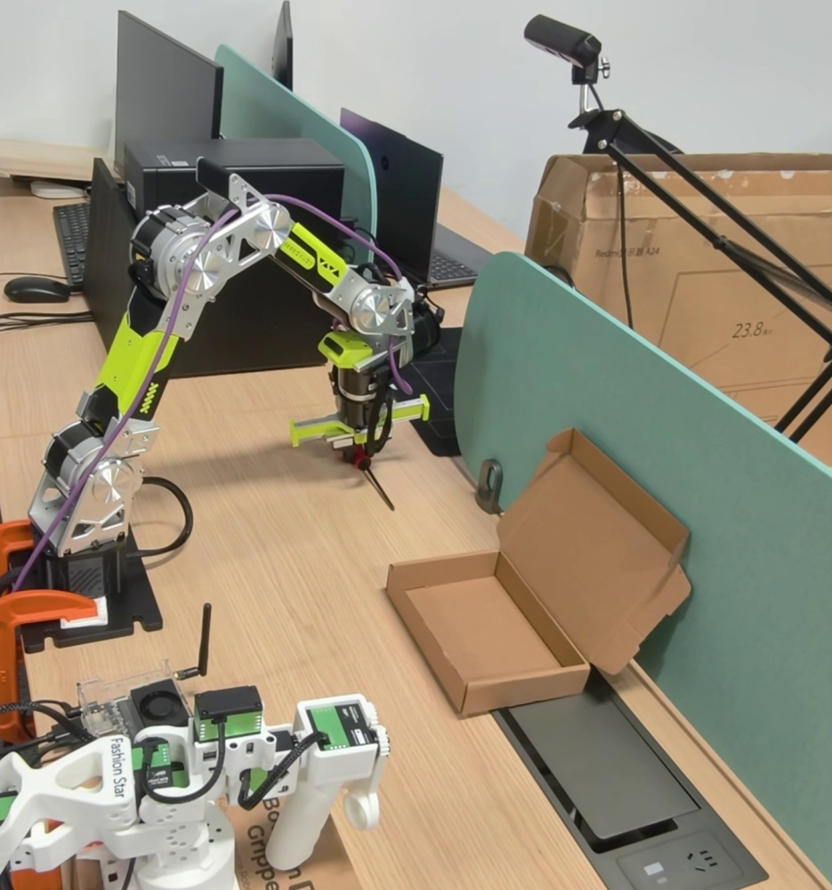

# B601-Pi0.5 云端 VLA 操控系统

**西安电子科技大学杭州研究院（西电杭研院）**

基于 Pi0.5/OpenPI 的 B601 微调适配与云端部署工程。系统融合顶置、腕部双相机观测与七维关节状态，在云端生成动作序列，由 Jetson Orin NX 驱动 B601-RS 机械臂完成螺丝刀抓取、盒内放置与回撤。

## 实机演示



*B601-RS 抓取螺丝刀，视频第 6.6 秒。*

[观看演示视频 · MP4](media/b601-pi05-demo.mp4)

## 技术实现

- **Pi0.5 LoRA 微调**：完成 B601 数据适配、训练集划分与归一化，采用 `gemma_2b_lora` 和 `gemma_300m_lora`。
- **双相机观测**：顶置 RGB、腕部 RGB 与七维实测关节角组成策略输入。
- **云端策略服务**：A100 上运行 OpenPI，通过 SSH 隧道与 WebSocket 向 Jetson 返回 `16 × 7` 绝对弧度动作序列。
- **本地轨迹执行**：Jetson 完成弧度/角度转换、轨迹跟踪、MIT 控制、夹爪适配及 J2 重力前馈补偿。
- **运行诊断**：记录关节反馈、温度、动作块进度、通信时序与控制状态。

## 系统架构


## 训练与运行记录

| 项目 | 配置 / 记录 |
|---|---|
| 微调数据 | 59 个训练 episodes，15,997 帧 |
| 训练配置 | 14 Hz，batch 8，6,000 次更新，horizon 16 |
| 推理配置 | 10 步 flow，每次完整执行 16 点后重新观测 |
| 第一轮演示 | 33 次预测，528 点执行，约 182 秒 |
| 第二轮演示 | 36 次预测，35 段 / 560 点执行，约 183 秒 |
| 第二轮最高反馈温度 | 46°C |

模型、运动配置及运行日志说明见[参数与运行记录](docs/BASELINE.md)。

## 项目结构

| 目录 | 内容 |
|---|---|
| `jetson/tools/` | 控制、采集、远程策略 worker 与离线测试 |
| `jetson/calibration/` | 关节标定、模型选择和运动配置 |
| `jetson/launchers/` | Jetson Linux 启动入口 |
| `server/inference/` | 云端推理服务与 systemd 单元 |
| `server/openpi_overlay/` | OpenPI 的 B601 适配、训练配置与数据加载改动 |
| `server/environment/` | 云端依赖版本与环境配置 |
| `training/` | 数据划分、归一化统计与训练说明 |
| `third_party/seeed_b601/` | Seeed 重力计算、RS URDF 与 MIT 许可证 |
| `media/` | 演示视频与预览图 |
| `docs/` | 部署、参数与源码来源 |
| `scripts/` | SSH 隧道入口与源码校验 |

## 使用

部署平台为 Jetson Orin NX / Linux 与云端 GPU。完整模型权重、训练数据和厂商 SDK 单独配置。

1. 按[部署说明](docs/DEPLOYMENT.md)配置 Jetson、云端环境及源码路径。
2. 查看[训练说明](training/README.md)与[参数配置](docs/BASELINE.md)。
3. 在 Windows 或 Linux 上检查源码：

```bash
python scripts/verify_source.py
```

## 代码来源

本项目为西安电子科技大学杭州研究院的 B601 微调适配与云端部署工作。基础模型与 OpenPI 来自 [Physical Intelligence](https://github.com/Physical-Intelligence/openpi)，B601 重力计算与 URDF 来自 [Seeed](https://github.com/Seeed-Projects/lerobot-robot-seeed-b601)。OpenPI 相关代码使用 Apache-2.0，Seeed 相关代码使用 MIT，详见[第三方说明](THIRD_PARTY_NOTICES.md)。
